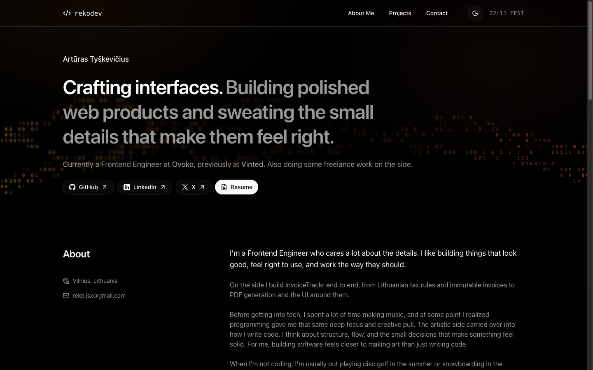

# rekodev

Personal site of Artūras Tyškevičius, Frontend Engineer at Ovoko (previously Vinted).

**Live:** [portfolio-rekodev.vercel.app](https://portfolio-rekodev.vercel.app)



## What's on it

- **Experience:** Ovoko, Vinted and Edigino, with a downloadable one-page resume
- **Selected work:** InvoiceTrackr, the Zero Guess Claude Code plugin and the Gargždai tourism kiosk
- **InvoiceTrackr case study** at `/projects/invoicetrackr`: problem, architecture, tradeoffs
- Monochrome light and dark themes in Geist, over a slowly moving orange ASCII soundwave (paused for reduced motion)

## Stack

- [Next.js 16](https://nextjs.org) (App Router, server components by default)
- React 19 and TypeScript 7
- Tailwind CSS 4 with shadcn/ui primitives
- next-themes for light, dark and system themes
- Deployed on Vercel

## Getting started

Requires Node.js 24 and pnpm.

```bash
pnpm install
pnpm dev
```

Then open [localhost:3000](http://localhost:3000).

| Command                  | What it does                     |
| ------------------------ | -------------------------------- |
| `pnpm dev`               | Start the dev server (Turbopack) |
| `pnpm build`             | Build for production             |
| `pnpm start`             | Serve the production build       |
| `pnpm lint`              | Lint with ESLint                 |
| `pnpm exec tsc --noEmit` | Typecheck with TypeScript 7      |

## Editing content

Almost all copy lives in data files, not in components.

| What                          | Where                                                             |
| ----------------------------- | ----------------------------------------------------------------- |
| Projects, experience, socials | `lib/constants.ts`                                                |
| InvoiceTrackr case study      | `lib/case-studies.ts`                                             |
| Hero and about copy           | `components/hero-section.tsx`, `components/about-section.tsx`     |
| Colors and ASCII backdrop     | `app/globals.css` (`--ascii-*`, `--glow-*`), `lib/ascii-field.ts` |
| Project images                | `public/projects/`                                                |
| Resume PDF                    | `public/arturas-tyskevicius-resume.pdf`                           |

The resume is exported from Google Docs. To update it, edit the Doc, download it as PDF and replace the file above.

The kiosk map inset is two static renders of the open Positron and Dark styles from [OpenFreeMap](https://openfreemap.org), so the site ships no map library. To move the pin, re-render both `public/projects/gargzdai-map-*.png` around the new coordinates.

## Notes on tooling

TypeScript 7 doesn't ship the compiler API yet, which typescript-eslint and Next.js still need. `package.json` therefore aliases `typescript` to `@typescript/typescript6` for tooling and installs TypeScript 7 as `@typescript/native`, which provides `tsc`. Drop the alias once typescript-eslint supports TS 7.

## License

The code is free to read and learn from. Please don't republish the content, images or resume as your own.
